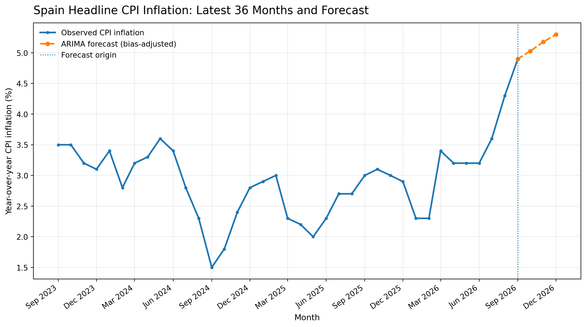
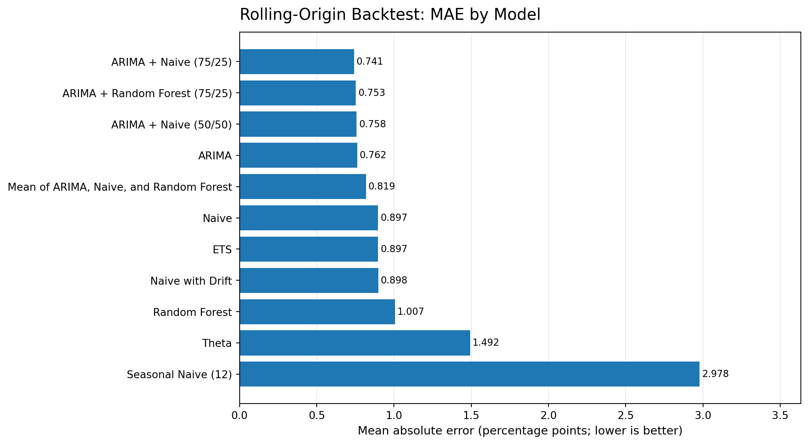

# Spanish CPI Inflation Forecasting with Time-Series Models

A reproducible R project for forecasting Spain's headline Consumer Price Index (CPI) year-over-year inflation. The project compares statistical benchmarks, a Random Forest model, and fixed-weight forecast ensembles using an expanding-window rolling-origin backtest.

> **Archived run:** 18 October 2026. The latest observation in that run was September 2026 (4.9% year-over-year). Forecasts for October–December 2026 are historical estimates from that run, not current official CPI readings.

## Research objective

Can a transparent time-series forecasting workflow improve short-horizon forecasts of Spanish CPI inflation when compared with simple benchmarks? The analysis evaluates one-, two-, and three-month-ahead forecasts and tests whether forecast combinations improve on individual models.

## Main findings from the archived run

- **ARIMA was the strongest individual model**, with a global MAE of **0.762 percentage points** and RMSE of **1.032** across 180 forecast errors.
- The **ARIMA + Naive (75/25)** fixed-weight ensemble achieved the lowest MAE among the tested combinations (**0.741**; RMSE **1.024**).
- Forecast accuracy worsened as the horizon increased, a common challenge for short monthly macroeconomic series.
- The tested rolling bias adjustment **increased MAE for every individual model** in the archived evaluation. The project therefore does not recommend applying it automatically.
- Random Forest was useful as a nonlinear benchmark but did not outperform ARIMA on this particular sample. The result is specific to this series and validation window; it is not a general claim about machine learning models.





## Forecast snapshot: October–December 2026

These were the point forecasts available in the submitted run. They should be interpreted as estimates made on 18 October 2026 from data through September 2026, not as published CPI figures.
The table uses **raw (unadjusted) forecasts** from the extended comparison and ensemble stages. The 36-month chart above separately illustrates the main script’s **bias-adjusted ARIMA forecast**. The archived evaluation found that bias adjustment increased MAE, so the chart is illustrative rather than the recommended forecast path.

| Target month | ARIMA | Naive | Random Forest | ARIMA + Naive (50/50) | ARIMA + Naive (75/25) | ARIMA + Random Forest (75/25) | Mean of ARIMA, Naive and RF |
|---|---:|---:|---:|---:|---:|---:|---:|
| October 2026 | 5.025% | 4.900% | 4.794% | 4.962% | 4.993% | 4.967% | 4.906% |
| November 2026 | 5.139% | 4.900% | 4.894% | 5.019% | 5.079% | 5.078% | 4.978% |
| December 2026 | 5.179% | 4.900% | 4.876% | 5.039% | 5.109% | 5.103% | 4.985% |

## Methodology

- **Data:** official INE Tempus3 API series for Spanish headline CPI year-over-year inflation. The workflow joins the historical 2021-base series to the current 2025-base series, preferring the newer series where dates overlap.
- **Individual models:** seasonal ARIMA, Naive, seasonal Naive (12), Random Forest, ETS, Theta, and Naive with drift.
- **Random Forest features:** lagged inflation, rolling means and standard deviation, plus sine/cosine month-of-year features. Forecasts are generated recursively for multi-step horizons.
- **Validation:** expanding-window rolling-origin backtest, up to 60 monthly origins and horizons from one to three months. Every forecast is generated using observations available at its origin in the stored monthly series.
- **Metrics:** mean absolute error (MAE) and root mean squared error (RMSE), both expressed in percentage points. Lower values indicate lower historical error.
- **Ensembles:** fixed-weight blends of ARIMA, Naive and Random Forest. Weights are prespecified rather than optimized on the same evaluation sample.
- **Bias adjustment:** recent historical forecast errors are tested by model and horizon; the saved results show that this adjustment worsened aggregate MAE in the evaluated sample.

See [Methodology](docs/METHODOLOGY.md), [Results](docs/RESULTS.md), the [data dictionary](docs/DATA_DICTIONARY.md), and [reproducibility notes](docs/REPRODUCIBILITY.md) for details.

## Repository structure

```text
.
├── R/
│   ├── 01_dynamic_forecast.R
│   ├── 02_extended_model_comparison.R
│   ├── 03_ensemble_forecasts.R
│   └── 04_review_results.R
├── results/
│   ├── figures/             # English publication-ready charts
│   ├── snapshot/            # English-readable CSV snapshots from 2026-10-18
│   └── working/             # Intermediate CSVs used by the multi-script R pipeline
├── docs/
│   ├── METHODOLOGY.md
│   ├── RESULTS.md
│   └── DATA_DICTIONARY.md
├── CITATION.cff
├── LICENSE
└── README.md
```

The `results/working/` filenames and some field names retain the original pipeline's Spanish labels to preserve compatibility across the supplied R scripts. The curated files in `results/snapshot/` are the English-readable tables intended for browsing and reuse.

## Run the analysis

### Requirements

- R 4.3 or later recommended
- RStudio (optional, but convenient)
- Internet access to query the INE API
- R packages: `httr`, `jsonlite`, `dplyr`, `purrr`, `tibble`, `readr`, `lubridate`, `ranger`, `forecast`, `ggplot2`, and `tidyr`

The first two scripts install missing dependencies when needed. The later scripts check their dependencies and stop if a package is missing.

### Execution order

From the repository root, run the scripts in this order:

1. `source("R/01_dynamic_forecast.R")` — download the latest INE data, run the four-model rolling-origin backtest, write forecasts and metrics.
2. `source("R/02_extended_model_comparison.R")` — add ETS, Theta, and Naive-with-Drift results, evaluate bias correction, and produce the extended October–December evaluation.
3. `source("R/03_ensemble_forecasts.R")` — evaluate fixed-weight forecast combinations.
4. `source("R/04_review_results.R")` — print the saved results and regenerate the latest-36-month chart.

The first script uses a forecast end date of December 2026 for the original competition horizon. To adapt the project to another date, update `FECHA_FINAL_CONCURSO` in `R/01_dynamic_forecast.R` and review the seasonal evaluation window in the downstream scripts.

## Data source

- Spanish National Statistics Institute (INE), Tempus3 API: <https://servicios.ine.es/wstempus/js/ES/DATOS_SERIE/>
- Series used by the pipeline: `IPC251856` (historical, 2021 base) and `IPC290750` (current, 2025 base).

The included results are a dated research snapshot. Running the code downloads the latest available data and may therefore produce different values from the archived tables.

## Limitations and responsible interpretation

- A low backtest error does not guarantee future accuracy. The results depend on the validation window, target series and historical regime.
- The model is primarily univariate: it does not directly incorporate energy prices, wages, exchange rates, monetary policy, taxes or other explanatory variables.
- The archived bias-correction calculation uses monthly observation dates as stored in the series. The code does not model the exact publication-release calendar of INE CPI observations, so causal interpretation of information availability should be treated cautiously.
- The October–December-only evaluation is based on a relatively small number of historical years and is therefore noisy.
- The target is the year-over-year inflation rate, not the CPI index level.
- The repository includes the results snapshot from the supplied project delivery. The scripts were reviewed for reproducibility issues, but they have not been executed end-to-end in this build environment; run them locally in R and validate fresh outputs before relying on them.

## Author

**Oriol Salmerón Mundó**  
GitHub: [@Oriol-Salmeron](https://github.com/Oriol-Salmeron)  
LinkedIn: [Oriol Salmerón](https://www.linkedin.com/in/oriol-salmeron-mund%C3%B3-72bab1234/)

## License

Code is released under the MIT License. The INE data remain subject to the terms applicable to the original data source. Forecasts are for research and educational purposes only, not investment, policy or professional advice.
